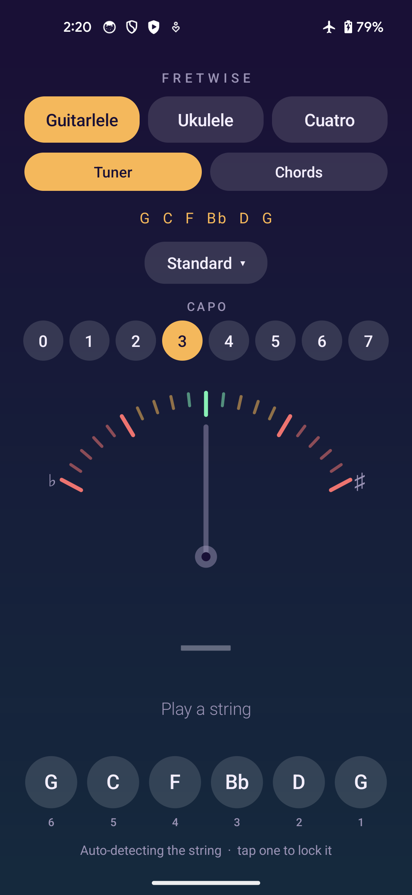
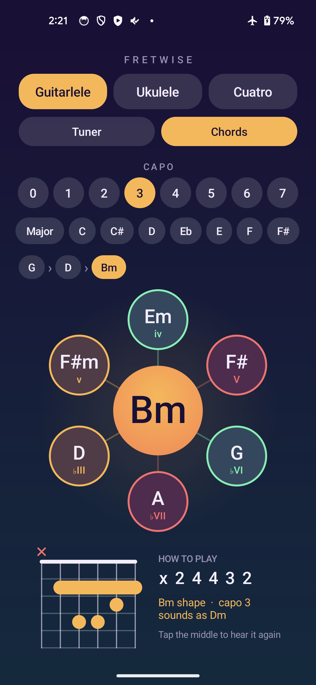
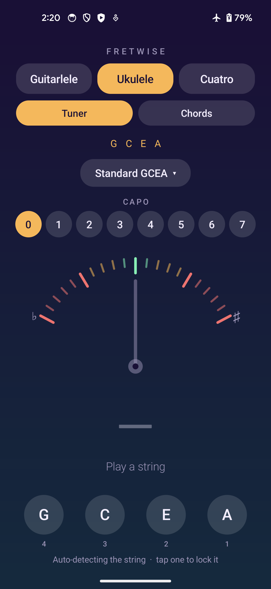
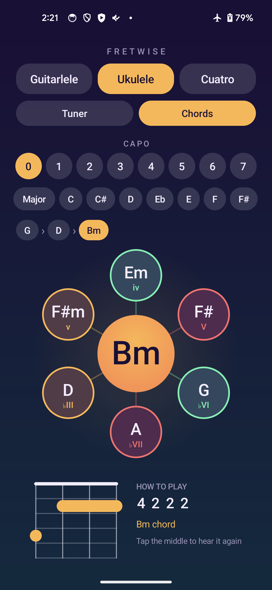
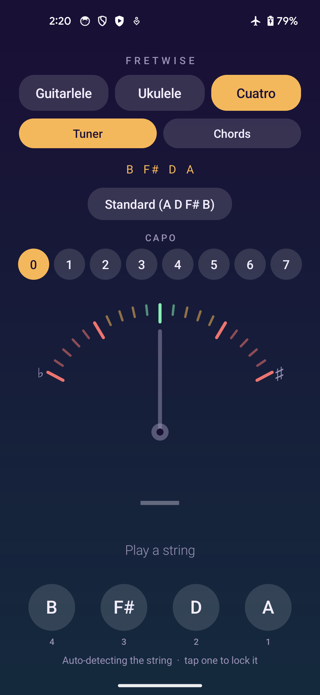
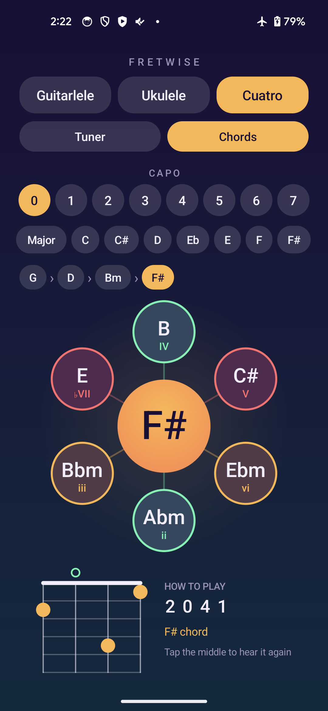

Fretwise is an Android tuner and chord finder for small string instruments: the guitarlele, the ukulele
and the Venezuelan cuatro. Pick your instrument once at the top and the tuner and the chord wheel both
follow it.

- Listens through the mic, finds which string you played and shows how many cents sharp or flat it is
- A swinging needle gauge that glows green when you're in tune (within 5 cents)
- Auto-detects the string, or tap a string to lock onto it
- Capo 0–7 on any instrument; each instrument remembers its own tuning and capo
- A chord wheel: start on any chord, see where it usually goes next, hear each chord and see the fingering

## Instruments

| Instrument | Tunings |
|---|---|
| Guitarlele | A guitar tuning plus a capo. Standard, Drop D, Half step down, DADGAD, Open G. Capo 3 is the default (G C F Bb D G); capo 5 gives A D G C E A; capo 6 gives Bb Eb Ab Db F Bb |
| Ukulele | Standard GCEA, Low G, Baritone DGBE, D tuning (ADF#B) |
| Cuatro venezolano | A D F# B, re-entrant (B3 F#4 D4 A4 from the lowest string) |

A guitarlele is a guitar tuned up with a capo, so it works as one: pick the guitar tuning, then the fret.

## Chord wheel

- Choose a start chord (any root, major or minor)
- The chord sits in the middle of a wheel; six chords that commonly follow it sit around it, coloured by
  role (home, away, tension)
- Tap one to move there. It strums the chord and shows the fingering (dots, open and muted strings,
  barres), and a trail of the path you took lets you step back
- Guitarlele chords use the usual guitar shapes. Ukulele and cuatro shapes are worked out from the strings'
  tuning (the easiest fingering that sounds the chord's three notes), so they follow Low G, baritone and so on
- With a capo the chord is the shape you play and the app tells you what it sounds as (a G shape at capo 3
  sounds as Bb)
- Major and minor chords only for now

## See it

Real screenshots from the app running on a phone.

<table>
<tr>
<td width="50%" valign="top">
 
Tuner · Guitarlele
<h3>Tune it with a capo</h3>
Pick a guitar tuning and a capo fret. Capo 3 gives G C F Bb D G.
</td>
<td width="50%" valign="top">
 
Chords · Guitarlele
<h3>Follow the wheel</h3>
Tap where a chord could go next. It plays the chord and shows how to finger it.
</td>
</tr>
<tr>
<td width="50%" valign="top">
 
Tuner · Ukulele
<h3>Ukulele tunings</h3>
Standard, low G, baritone and D tunings.
</td>
<td width="50%" valign="top">
 
Chords · Ukulele
<h3>Ukulele chords</h3>
The same wheel, with fingerings worked out for the four strings.
</td>
</tr>
<tr>
<td width="50%" valign="top">
 
Tuner · Cuatro
<h3>Venezuelan cuatro</h3>
The re-entrant A D F# B tuning, with the strings in neck order.
</td>
<td width="50%" valign="top">
 
Chords · Cuatro
<h3>Cuatro chords</h3>
Chord shapes fitted to the cuatro's tuning.
</td>
</tr>
</table>

## Build

Everything builds inside the `android-build:35` Docker image; nothing is installed on the host.

    docker run --rm -v "$PWD:/workspace" -w /workspace -v android-gradle:/root/.gradle \
      android-build:35 ./gradlew assembleRelease

The APK lands in `app/build/outputs/apk/release/app-release.apk`. Requires Android 11 (API 30) or newer.

### Signing

Builds are signed with a fixed key from `signing/guitarlele.jks`, configured by
`signing/keystore.properties`. The folder is not in git, so keep it safe: a different key means an update
won't install over the old app. Without it the build falls back to Android's default debug signing.

The app was first called Guitarlele Tuner, so the package is still `app.guitarlele.tuner`. Changing it
would make Android treat the app as a new one and lose the saved settings.

## How it works

- `Instrument` and `Tuning` hold the instruments and their tunings (add one there to support another)
- `PitchEngine` records from the mic and finds the pitch with the YIN algorithm
- `TunerView` and `StringsView` draw the gauge and the string buttons
- `Chord` holds chord shapes and the "what comes next" moves, `ChordWheelView` and `ChordDiagramView`
  draw them, and `ToneSynth` plays the chord from a few decaying harmonics per string
- Plain Java and the Android framework, no third-party libraries
