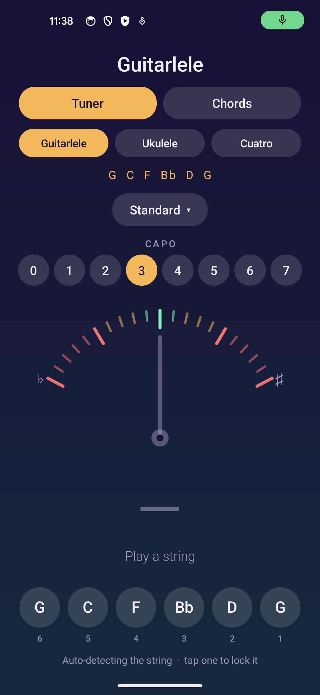
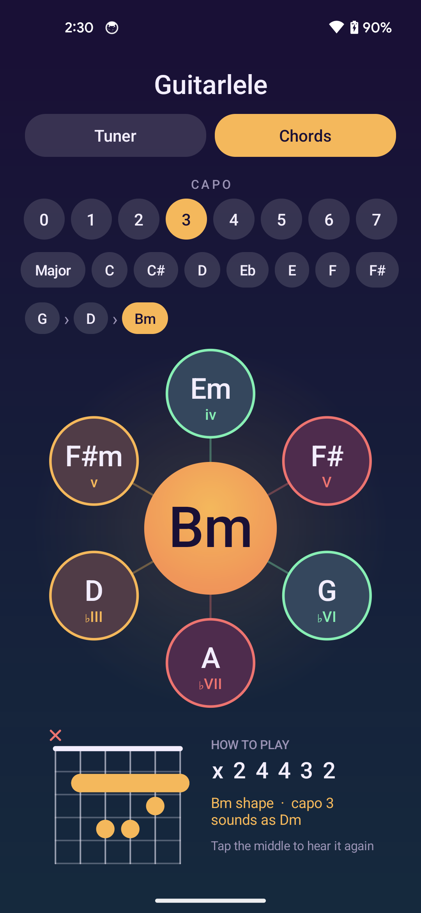
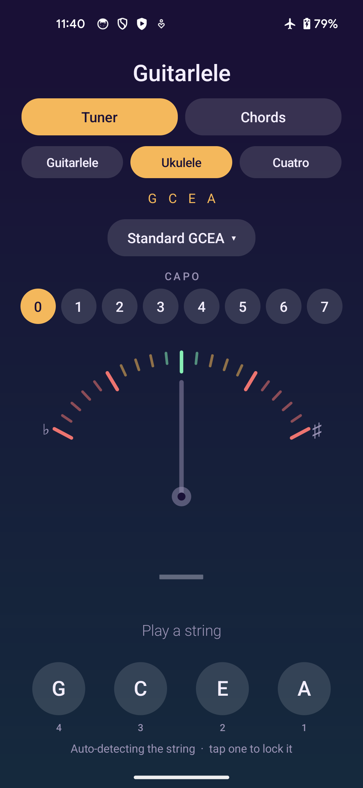
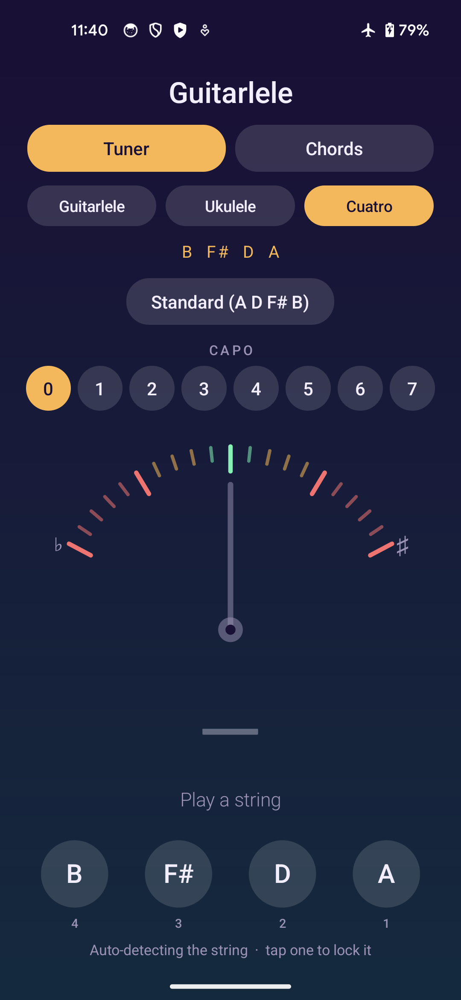

An Android app for guitarlele players. It tunes your instrument by ear through the microphone, and it
has a chord wheel that suggests where to go next, plays each chord and shows how to finger it.

A guitarlele is a guitar tuned up with a capo, so the tuner works that way: pick a guitar tuning, then
pick the capo fret (0–7). Capo 3 is the default; the common "classic" guitarlele tuning is capo 5.
It also tunes a ukulele and a Venezuelan cuatro.

## Tuner

- Listens through the mic, finds which string you played and shows how many cents sharp or flat it is
- A gauge with a smooth needle that glows green when you're in tune (within 5 cents)
- Auto-detects the string, or tap a string to lock onto it
- Instruments: Guitarlele, Ukulele, Cuatro venezolano. Each remembers its own tuning and capo
- Guitarlele: base tunings Standard, Drop D, Half step down, DADGAD, Open G, plus a capo (0–7)
- Ukulele: Standard GCEA, Low G, Baritone DGBE, D tuning (ADF#B)
- Cuatro venezolano: A D F# B, re-entrant (B3 F#4 D4 A4 from the lowest string)

| Base tuning + capo | Strings |
|---|---|
| Standard, capo 3 (default) | G C F Bb D G |
| Standard, capo 5 | A D G C E A |
| Standard, capo 6 | Bb Eb Ab Db F Bb |

## Chord wheel

- Choose a start chord (any root, major or minor)
- The chord sits in the middle of a wheel; six chords that commonly follow it sit around it, coloured by
  role (home, away, tension)
- Tap one to move there. It strums the chord and shows the guitar fingering (dots, open and muted
  strings, barres), and a trail of the path you took lets you step back
- Chord names are the guitar shapes you play; with a capo the sound is shifted and the app tells you what
  it sounds as (a G shape at capo 3 sounds as Bb)
- Major and minor chords only for now

## See it

Real screenshots from the app running on a phone.

<table>
<tr>
<td width="50%" valign="top">
 
Tuner
<h3>Tune it with a capo</h3>
Pick a guitar tuning and a capo fret. Capo 3 gives G C F Bb D G.
</td>
<td width="50%" valign="top">
 
Chords
<h3>Follow the wheel</h3>
Tap where a chord could go next. It plays the chord and shows how to finger it.
</td>
</tr>
<tr>
<td width="50%" valign="top">
 
Ukulele
<h3>Other instruments too</h3>
Standard, low G, baritone and D tunings for the ukulele.
</td>
<td width="50%" valign="top">
 
Cuatro
<h3>Venezuelan cuatro</h3>
The re-entrant A D F# B tuning, with the strings in neck order.
</td>
</tr>
</table>

## Build

Everything builds inside the `android-build:35` Docker image; nothing is installed on the host.

    docker run --rm -v "$PWD:/workspace" -w /workspace -v android-gradle:/root/.gradle \
      android-build:35 ./gradlew assembleRelease

The APK lands in `app/build/outputs/apk/release/app-release.apk`. Requires Android 11 (API 30) or newer.

### Signing

Builds are signed with a fixed key from `signing/guitarlele.jks`, configured by
`signing/keystore.properties`. The folder is not in git, so keep it safe: a different key means an update
won't install over the old app. Without it the build falls back to Android's default debug signing.

## How it works

- `Instrument` and `Tuning` hold the instruments and their tunings (add one there to support another)
- `PitchEngine` records from the mic and finds the pitch with the YIN algorithm
- `TunerView` and `StringsView` draw the gauge and the string buttons
- `Chord` holds chord shapes and the "what comes next" moves, `ChordWheelView` and `ChordDiagramView`
  draw them, and `ToneSynth` plays the chord from a few decaying harmonics per string
- Plain Java and the Android framework, no third-party libraries
